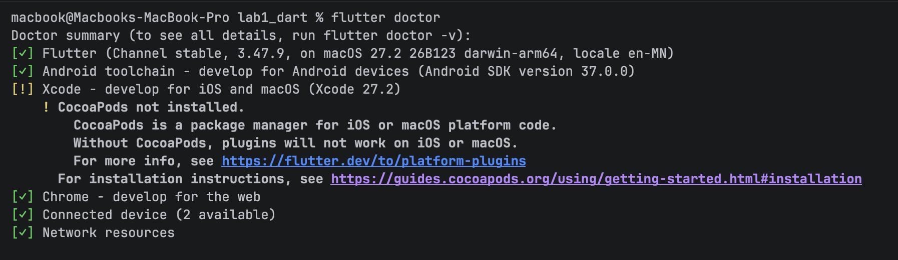
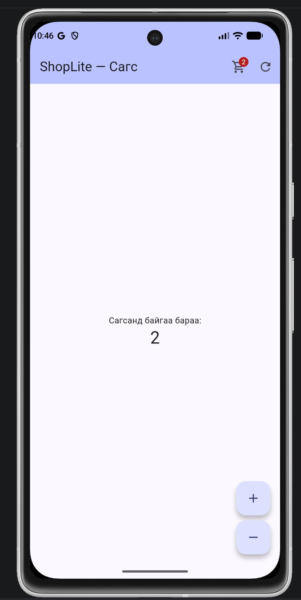

# ShopLite — Мобайл апп хөгжүүлэлт (Flutter)

**Нэр:** Dashryenchin  
**Оюутны код:** 23B1NUM1789

Энэ репозиторид 6 долоо хоногийн турш бүх лабораторийн кодоо хадгална.

```
├── README.md          ← энэ файл (доорх хэсгүүдийг бөглөнө)
├── screenshots/       ← дэлгэцийн зураг
├── lab1_dart/         ← Лаборатори 1: Dart дасгал
└── shoplite/          ← Лаборатори 1-д `flutter create`-оор үүсгэнэ
```

## Код хадгалах (лаборатори бүрийн төгсгөлд)

```bash
git add .
git commit -m "Lab 1: Dart модель, shoplite апп"
git push
git tag v0.1            # Лаб 1 → v0.1, Лаб 2 → v0.2, ...
git push origin v0.1
```

Push хийсний дараа GitHub дээрх **Actions** табаас автомат тестийн үр дүнг (ногоон ✓ / улаан ✗) харна.
`lab1_dart/test/` болон `.github/` хавтасны файлуудыг **өөрчлөхгүй**.

---

## Лаборатори 1




### lab1_dart

- `dart test test/lab1_test.dart`: 26 / 26 (All tests passed!), `dart analyze`: No issues found!
- Бонус B1 (`dart test test/bonus_test.dart`): хийсэн ✓

### shoplite

- `flutter test`: 3 / 3 тест амжилттай, `flutter analyze`: No issues found!
- D3 (a–g) бүх шаардлага хийгдсэн
- Бонус B2 (AppBar дээр `Badge`-тэй сагсны тоо): хийсэн ✓

### D2. Төслийн бүтэц

1. `lib/main.dart`-д ямар классууд байна? Аль нь StatelessWidget, аль нь StatefulWidget вэ?
   > `ShopLiteApp` — StatelessWidget (аппын үндэс, `MaterialApp`, theme тохируулна).
   > `CartPage` — StatefulWidget (өөрчлөгддөг төлөвтэй дэлгэц).
   > `_CartPageState` — `CartPage`-ийн `State` класс; `_count` төлөв ба `build()` энд байна.
2. `pubspec.yaml`-д ямар сангууд байна?
   > `dependencies`: `flutter` (SDK), `cupertino_icons`.
   > `dev_dependencies`: `flutter_test` (SDK), `flutter_lints`.
3. `android/` хавтас юунд хэрэгтэй вэ? Та ихэвчлэн аль хавтсанд код бичих вэ?
   > `android/` нь Android-д зориулсан native төсөл (Gradle тохиргоо, `AndroidManifest.xml`, app icon, package нэр, minSdk гэх мэт) бөгөөд Android дээр build хийж APK/AAB гаргахад хэрэгтэй.
   > Код ихэвчлэн `lib/` хавтсанд (Dart код), тестийг `test/` хавтсанд бичнэ.

### D4. Hot reload ба hot restart

| Өөрчлөлт | Hot reload (r) | Hot restart (R) |
|---|---|---|
| AppBar-ийн гарчгийг өөрчлөх | Гарчиг шууд солигдсон, тоолуур 3 хэвээр | Гарчиг солигдсон, тоолуур 0 болсон |
| seed өнгийг солих | Өнгө солигдсон, тоолуур 3 хэвээр | Өнгө солигдсон, тоолуур 0 болсон |
| `int _count = 0;` → `= 5` | Юу ч өөрчлөгдөөгүй, тоолуур 3 хэвээр | Тоолуур 5-аас эхэлсэн |
| `main()` дотор `print('start');` нэмэх | `start` хэвлэгдээгүй (main дахин ажиллаагүй), тоолуур 3 хэвээр | `start` терминалд хэвлэгдсэн, тоолуур анхны утгадаа орсон |

**Дүгнэлт:** аль тохиолдолд тоолуурын утга (state) хадгалагдсан бэ? Яагаад?
> Hot reload (r) үед бүх тохиолдолд тоолуурын утга хадгалагдсан. Hot reload нь өөрчлөгдсөн кодыг ажиллаж буй Dart VM-д оруулаад зөвхөн `build()`-ийг дахин дууддаг; `State` объект устахгүй тул `_count` хадгалагдана. Мөн `_count`-ийн анхны утга (`= 5`) нь State үүсэх үед л ажилладаг тул reload хийхэд үйлчлэхгүй, `main()` ч дахин ажиллахгүй.
> Hot restart (R) нь аппыг `main()`-ээс эхлүүлж, бүх State-ийг шинээр үүсгэдэг тул төлөв алдагдаж, тоолуур анхны утгаасаа эхэлнэ.
